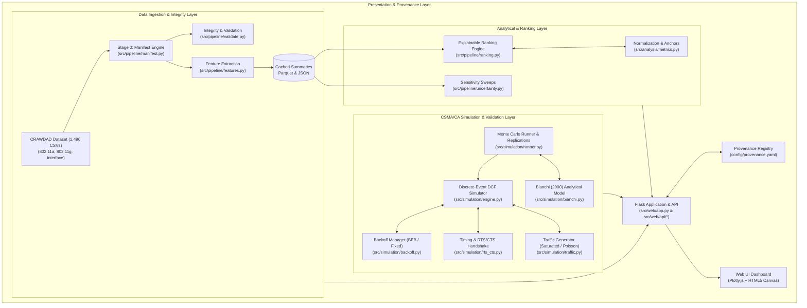
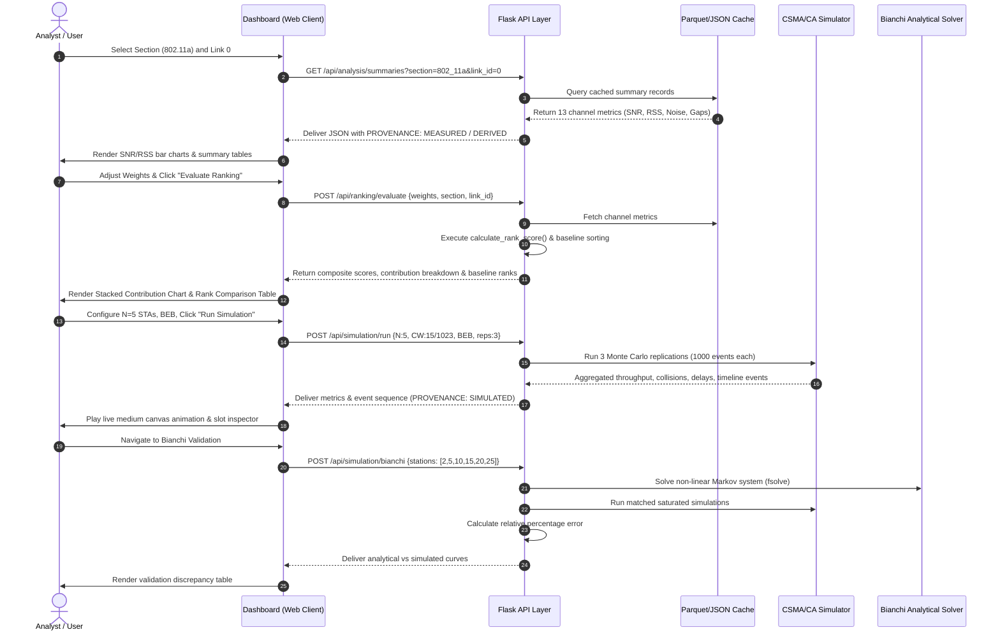

# 03. System Architecture and Implementation

---

## 1. System Architecture

The WLAN Observatory system follows a modular, decoupled architecture consisting of an ingestion & caching pipeline, an analytical ranking engine, an event-driven CSMA/CA simulator, an analytical Markov chain solver, and a Flask presentation layer.

---

## 2. Technology Stack Justification

| Technology | Role | Technical Justification |
| :--- | :--- | :--- |
| **Python 3.12** | Core Runtime | Provides high-performance standard library features, strong typing (`typing`, `dataclasses`), and ecosystem support for numerical computing. |
| **Flask 3.1** | Web Framework | Lightweight, modular WSGI framework ideal for exposing structured REST APIs and serving server-rendered Jinja2 engineering templates without bloated full-stack overhead. |
| **Pandas & NumPy** | Data Processing | Efficient array transformations, vector math for signal statistics, and rapid chunked ingestion of CSV traces. |
| **SciPy (`scipy.optimize.fsolve`)**| Numerical Analysis | Solves Bianchi's coupled non-linear equations for $\tau$ and $p$ with robust convergence properties. |
| **PyArrow / Parquet** | Storage & Caching | Columnar on-disk caching format enabling sub-millisecond retrieval of channel summary statistics without reparsing multi-gigabyte raw text traces. |
| **Plotly.js (2.27)** | Dashboard Charts | Client-side, interactive SVG/WebGL charts supporting dual y-axes, stacked bars, scatter plots, and hover inspectors. |
| **HTML5 Canvas** | Simulator Animation | Enables high-frequency, lightweight 60 FPS rendering of station contention states and wireless medium occupancy. |
| **Pytest & Coverage** | Verification & QA | Automated regression test execution, test fixture isolation, and line-by-line coverage verification. |

---

## 3. Data Flow Architecture

---

## 4. Detailed Component Implementation

### 4.1 Ingestion & Manifest Pipeline (`src/pipeline/manifest.py`)
- **Purpose:** Ingests raw CSV captures, extracts metadata, enforces deterministic regex routing, and computes SHA-256 hashes.
- **Routing Rules:**
  - `802_11a/link-(?P<link>\d+)-channel-(?P<channel>\d+)\.csv` $\rightarrow$ 5 GHz
  - `802_11g/link-(?P<link>\d+)-channel-(?P<channel>\d+)\.csv` $\rightarrow$ 2.4 GHz
  - `interface/link-(?P<link>\d+)-interface-(?P<iface>\d+)-(?P\d+)\.csv` $\rightarrow$ Diversity antenna pairs
- **Integrity Sample:** Inspects the first 200 rows of each file to confirm 8-column schema, timestamp monotonicity, 12-bit sequence boundaries ($0 \dots 4095$), and the identity check $\text{SNR} = \text{RSS} - \text{Noise}$.

### 4.2 Multi-Criteria Channel Ranking (`src/pipeline/ranking.py`, `src/analysis/metrics.py`)
- **Inputs:** `snr_mean`, `snr_std`, `noise_mean`, `data_rate_mode`, weights vector ($w_{\text{snr}}, w_{\text{stability}}, w_{\text{noise}}, w_{\text{rate}}$), physical anchors dictionary.
- **Normalization Formula:**
  - $\text{Norm}_{\text{SNR}} = \text{clamp}\left(\frac{\text{snr\_mean} - 5.0}{45.0 - 5.0}, 0.0, 1.0\right)$
  - $\text{Norm}_{\text{Stability}} = \text{clamp}\left(\frac{1.0}{1.0 + \text{snr\_std}}, 0.0, 1.0\right)$
  - $\text{Norm}_{\text{Noise}} = \text{clamp}\left(\frac{-75.0 - \text{noise\_mean}}{-75.0 - (-100.0)}, 0.0, 1.0\right)$
  - $\text{Norm}_{\text{Rate}} = \text{clamp}\left(\frac{\text{data\_rate} - 6.0}{54.0 - 6.0}, 0.0, 1.0\right)$
- **Composite Score Equation:**
  $$\text{Composite Score} = 100 \times \sum_{i \in \{\text{snr}, \text{stab}, \text{noise}, \text{rate}\}} w_i \cdot \text{Norm}_i$$
- **Baseline Implementations:** Simultaneously sorts channels by single criteria:
  1. Median SNR descending (`baseline_snr_rank`).
  2. Mean RSS descending (`baseline_rss_rank`).
  3. Mean Noise ascending (`baseline_noise_rank`).

### 4.3 Discrete-Event CSMA/CA Simulator (`src/simulation/engine.py`)
- **State Machine & Slot Rules:**
  - Standard IEEE 802.11a slot time: $\sigma = 9\,\mu\text{s}$, $\text{SIFS} = 16\,\mu\text{s}$, $\text{DIFS} = 34\,\mu\text{s}$.
  - When the medium is idle and stations have packets, backoff counters decrement by 1 per slot.
  - Stations with backoff counter $=0$ transmit simultaneously.
  - Transmissions freeze all non-transmitting station counters for the exact duration of the frame on the medium.
- **Transmission Timings (`src/simulation/rts_cts.py`):**
  - Basic Access:
    $$T_{\text{succ}} = T_{\text{coll}} = \text{DIFS} + T_{\text{data}} + \text{SIFS} + T_{\text{ack}}$$
    where $T_{\text{data}} = T_{\text{preamble}} + \frac{(L_{\text{payload}} + L_{\text{mac\_header}}) \times 8}{R_{\text{data}}}$
  - RTS/CTS Handshake:
    $$T_{\text{succ}} = \text{DIFS} + T_{\text{rts}} + \text{SIFS} + T_{\text{cts}} + \text{SIFS} + T_{\text{data}} + \text{SIFS} + T_{\text{ack}}$$
    $$T_{\text{coll}} = \text{DIFS} + T_{\text{rts}} + \text{SIFS} + T_{\text{cts}}$$
- **Contention Window Policies (`src/simulation/backoff.py`):**
  - **BEB:** On collision, $CW_{\text{next}} = \min((CW + 1) \times 2 - 1, CW_{\max})$. Resets to $CW_{\min}$ on success or when retry limit ($7$) is exceeded.
  - **FIXED:** Preserves $CW_{\min}$ regardless of collision count.

### 4.4 Bianchi 2000 Analytical Model Solver (`src/simulation/bianchi.py`)
- **System of Equations:**
  $$p = 1 - (1 - \tau)^{n - 1}$$
  $$\tau = \frac{2(1 - 2p)}{(1 - 2p)(W + 1) + pW(1 - (2p)^m)}$$
  where $W = CW_{\min} + 1$, $2^m W = CW_{\max} + 1$, $n = \text{stations}$.
- **Expected Saturation Throughput:**
  $$S = \frac{P_{\text{tr}} P_s E[P]}{(1 - P_{\text{tr}})\sigma + P_{\text{tr}}P_s T_s + P_{\text{tr}}(1 - P_s)T_c}$$
  where $P_{\text{tr}} = 1 - (1 - \tau)^n$ and $P_s = \frac{n\tau(1 - \tau)^{n-1}}{P_{\text{tr}}}$.

### 4.5 Provenance Enforcement (`src/common/provenance.py`)
- Metric definitions and sources are specified in `config/provenance.yaml`.
- The `tag(name, value)` method enforces registry membership: any attempt to pass an unregistered metric to UI consumers raises a `KeyError`, preventing unauthorized or fabricated metrics from surfacing in the interface.
